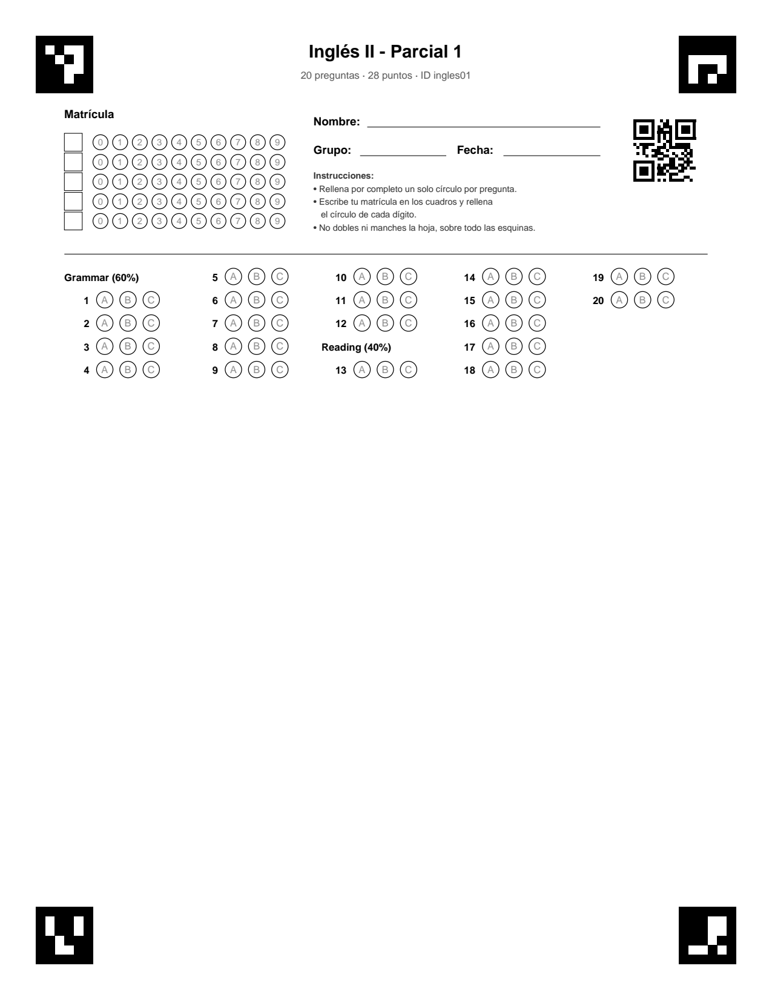

# Calificador de exámenes

Califica exámenes de opción múltiple a partir de una **foto con el celular**
de la hoja de respuestas.

1. Describes el examen (secciones, preguntas, respuestas correctas, puntos).
2. El sistema genera el **PDF de la hoja de respuestas** para imprimir.
3. Los alumnos rellenan las burbujas, incluida su **matrícula**.
4. Le tomas foto a cada hoja y el sistema lee la matrícula y las respuestas,
   calcula la **nota** y la guarda.
5. Exportas los resultados a CSV (se abre en Excel).

No hace falta escanear ni que la foto salga derecha: la hoja lleva cuatro
marcadores en las esquinas y un código QR, así que se reconoce aunque esté
girada, en ángulo o con sombras, y el sistema sabe solo de qué examen es.



## Qué puede hacer

- Exámenes de **2 a 8 opciones** (A-H) con **una** respuesta correcta.
- **Secciones** con peso en porcentaje (p. ej. Álgebra 40 %, Geometría 60 %)
  o calificación por suma de puntos; cada pregunta puede valer distinto.
- **Matrícula** de 1 a 12 dígitos, leída de la propia hoja.
- **Nunca adivina:** si una pregunta tiene dos marcas, una marca muy tenue
  o tachada, queda como *ambigua*, vale 0 y se marca para que la revises.
  Lo mismo si un dígito de la matrícula no se puede leer.
- Funciona con lápiz suave, lápiz fuerte o pluma: cada hoja se calibra con
  las marcas del propio alumno.
- Por cada hoja guarda una **imagen de revisión** con colores: verde
  correcta, rojo incorrecta, naranja ambigua, gris en blanco.
- Si escaneas dos veces la misma matrícula, se guardan ambas y **tú eliges**
  cuál cuenta.

## Instalación

Requiere Python 3.11 o más nuevo.

```bash
git clone <url-del-repo>
cd Calificador
python -m venv venv
source venv/bin/activate        # en Windows: venv\Scripts\activate
pip install -r requirements.txt
```

Todos los comandos se corren desde la carpeta `Calificador/` con el `venv`
activado.

Así ya funciona todo en la computadora, con una base de datos local
(SQLite). Para usar la base de datos en la nube con cuentas de usuario,
ve [Usar Supabase](#usar-supabase-base-de-datos-en-la-nube-y-cuentas).

## Uso

### 1. Describe el examen

Por ahora los exámenes se escriben en un archivo JSON. Hay ejemplos en
`data/examples/`:

```json
{
  "id": "ingles01",
  "name": "Inglés II - Parcial 1",
  "num_options": 3,
  "student_id_digits": 5,
  "sections": [
    {"id": "grammar", "name": "Grammar", "weight": 60,
     "questions": [{"number": 1, "correct_answer": "B", "points": 1}, ...]},
    {"id": "reading", "name": "Reading", "weight": 40,
     "questions": [{"number": 13, "correct_answer": "C", "points": 2}, ...]}
  ]
}
```

- `id`: identificador corto; va dentro del QR de la hoja.
- `num_options`: opciones por pregunta (4 = A, B, C, D).
- `student_id_digits`: dígitos de la matrícula.
- `weight`: porcentaje de la nota final de cada sección. Si lo usas, todas
  las secciones deben tenerlo y sumar 100. Si no lo pones en ninguna, la
  nota es la suma de puntos.

### 2. Regístralo y genera la hoja

```bash
python -m cli.exams add data/examples/ingles01.json
python -m cli.exams sheet ingles01 --preview
```

Guarda `data/sheets/ingles01.pdf` (y un `.png` para verla sin abrir el PDF).
Si el examen tiene errores (una respuesta que no está entre las opciones,
pesos que no suman 100, preguntas repetidas) o no cabe en una hoja, lo dice
antes de generar nada.

### 3. Imprime y aplica

- Imprime a **tamaño real** ("100 %"), **nunca** "ajustar a página".
- Revisa que los cuatro cuadros de las esquinas salgan **negro sólido**.
- Los alumnos rellenan un círculo por pregunta y su matrícula (escrita en
  los cuadros y rellenada en los círculos).

### 4. Toma las fotos

- Que se vean **los cuatro cuadros negros** de las esquinas, completos.
- Buena luz, sin reflejos fuertes sobre las esquinas ni sobre el QR.
- El ángulo y la orientación no importan.

Pasa las fotos a la computadora, por ejemplo a `data/raw/`.

### 5. Califica

```bash
python -m cli.grade data/raw/              # todas las fotos de la carpeta
python -m cli.grade data/raw/foto1.jpg     # una sola
python -m cli.grade data/raw/ --dry-run    # ver la nota sin guardar
```

```
OK foto1.jpg: examen 'ingles01'
    Matrícula: 02619
    Nota: 40 / 100
      Grammar: 4/12 (33%, vale 60%)
      Reading: 8/16 (50%, vale 40%)
    Ambiguas (valen 0, REVISAR): [10]
    En blanco: [9]
    Resultado: <id del resultado>
    Revisión: data/processed/results/ingles01/<id del resultado>.png
```

Abre la imagen de revisión para ver qué leyó en cada pregunta. Si el QR de
una hoja no se puede leer, indica el examen a mano:
`python -m cli.grade foto.jpg --exam ingles01`.

### 5b. O califica con la cámara, sin tomar fotos

```bash
python -m cli.scan                 # webcam de la computadora
python -m cli.scan --camera 1      # otra cámara (o una URL de video)
python -m cli.scan --dry-run       # sin guardar
```

Se abre la cámara: pon la hoja frente a ella con las cuatro esquinas a la
vista y déjala quieta un momento. El contorno se pone verde cuando se ven
las cuatro esquinas; cuando la lectura sale igual en varios cuadros
seguidos, la cámara **se cierra sola**, el resultado se guarda y aparece la
nota con dos opciones: **[N] calificar otro** o **[Q] salir**.

Además de la imagen de revisión se guarda el cuadro capturado. Para que la
lectura sea buena con una webcam, la hoja debe ocupar casi todo el cuadro.

### La web (recomendado)

Todo lo anterior se puede hacer desde el navegador, sin terminal: crear
cuenta, crear y editar exámenes (con botones por pregunta o pegando las
respuestas, p. ej. `ABDCA`), descargar el PDF en carta o A4, calificar con
la cámara o con fotos, y borrar exámenes.

La primera vez hay que compilar la web (necesita Node.js:
`sudo dnf install nodejs` en Fedora):

```bash
cd web && npm install && npm run build && cd ..
python -m api.serve
```

Y se abre la dirección que imprime (ver abajo). Después de cambiar algo en
`web/`, se vuelve a correr `npm run build`. Para trabajar en la web con
recarga automática: `python -m api.serve` en una terminal y `npm run dev`
en `web/` en otra (http://localhost:5173).

### 5c. O califica desde el celular (recomendado)

La cámara del celular es mucho mejor que la de una laptop. Con el celular y
la computadora en la **misma red Wi-Fi**:

```bash
python -m api.serve
```

Imprime una dirección (`https://<ip>:8000`) y un QR en la terminal; ábrela
en el navegador del celular. La primera vez saldrá "la conexión no es
privada" (el certificado es propio, de la computadora): toca
*Configuración avanzada → Continuar*. Ahí puedes:

- **Calificar con la cámara en vivo:** igual que `cli.scan`, pero con la
  cámara del celular. Si tiene varias cámaras, se elige abajo.
- **Tomar foto:** abre la cámara normal del celular (la mejor calidad).
- **Subir foto de la galería.**

Al terminar aparece la nota y la imagen de revisión, con **calificar otro**
o **salir**. Los resultados se guardan en la misma base de datos que usan
los comandos (marca *Solo probar* para no guardar).

`python -m api.serve --http` arranca sin HTTPS; así el celular solo puede
tomar o subir fotos (los navegadores no dejan usar la cámara en vivo sin
HTTPS).

### 6. Consulta y exporta los resultados

```bash
python -m cli.results list ingles01
python -m cli.results duplicates ingles01     # matrículas escaneadas 2+ veces
python -m cli.results choose <id>             # elegir cuál cuenta
python -m cli.results export ingles01         # → data/results/ingles01.csv
```

El CSV tiene una fila por alumno con su nota, el porcentaje de cada sección,
las preguntas ambiguas y en blanco, y su estado (`ok`, `revisar preguntas`,
`revisar matrícula` o `elegir resultado`).

### Administrar exámenes

```bash
python -m cli.exams list
python -m cli.exams show ingles01        # ver la clave de respuestas
python -m cli.exams update ingles01.json # corregir clave, puntos o pesos
python -m cli.exams delete ingles01      # borra el examen y sus resultados
```

- Si corriges la clave de respuestas, los puntos o los pesos de un examen ya
  calificado, **se recalifican solas** las hojas guardadas.
- Lo que cambia la hoja impresa (número de opciones, dígitos de matrícula,
  qué preguntas hay) **no se puede cambiar** una vez que el examen tiene
  resultados, porque las hojas ya impresas dejarían de coincidir.
- Borrar un examen pide confirmación y borra también sus resultados.

### Ver qué está pasando

Todos los comandos aceptan `-v` (qué paso se está haciendo) y `-vv` (además,
qué tan oscura midió cada burbuja). Útil si una hoja no se lee como
esperabas:

```bash
python -m cli.grade data/raw/foto1.jpg --dry-run -vv
```

## Usar Supabase (base de datos en la nube y cuentas)

Con Supabase cada profesor inicia sesión con su correo y solo ve sus
propios exámenes y resultados.

1. **Crea el proyecto** en [supabase.com](https://supabase.com) → *New
   project* (plan Free). Guarda la contraseña de la base de datos.
2. **Copia `.env.example` a `.env`** y llénalo:
   - `DATABASE_URL`: botón *Connect* → **Session pooler** → URI (con tu
     contraseña).
   - `SUPABASE_URL` y `SUPABASE_PUBLISHABLE_KEY`: *Project Settings → API
     Keys*. Nunca pongas la llave `secret` / `service_role`.
3. **Crea las tablas:**
   ```bash
   alembic upgrade head
   ```
   En *Table Editor* aparecen `exams`, `sections`, `questions` y `results`,
   con RLS activado (cada usuario solo puede ver sus filas).
4. **Usuarios:** cada profesor crea su cuenta en la web ("Crear cuenta").
   En *Authentication → Sign In / Providers* deben estar activos **Allow
   new users to sign up** y, para entrar sin confirmar el correo,
   desactivado **Confirm email**. También se pueden crear en
   *Authentication → Users → Add user*.
5. **Arranca** `python -m api.serve`: la página pide iniciar sesión.

Para que los comandos (`cli.exams`, `cli.grade`, …) guarden a nombre de
alguien, pon en el `.env` `CALIFICADOR_OWNER_ID=<uuid del usuario>` (está
en *Authentication → Users*).

Para pasar lo que ya tenías en la base local a un usuario de Supabase:

```bash
python scripts/migrate_sqlite.py --owner admin@correo.com --dry-run   # ver qué copiaría
python scripts/migrate_sqlite.py --owner admin@correo.com
```

Copia exámenes y resultados con los mismos ids (las hojas impresas siguen
sirviendo), se salta lo que ya esté y no toca la base local.

Los ids de examen son únicos entre **todos** los usuarios (van en el QR),
así que dos profesores no pueden tener los dos un examen `ingles01`.

## Cómo funciona

1. **Encuentra la hoja:** detecta los cuatro marcadores de las esquinas y
   lee el QR para saber de qué examen es.
2. **Sabe dónde está cada burbuja:** la posición se calcula con la misma
   cuenta que dibujó el PDF, así que no hay que calibrar nada a mano.
3. **Endereza la foto** usando los marcadores.
4. **Mide qué tan oscura está cada burbuja**, comparándola con el papel de
   alrededor y con cómo marca ese alumno en el resto de la hoja.
5. **Decide cada respuesta** (contestada, en blanco o ambigua) y **califica**.

Diagramas:
- [`docs/deteccion.pdf`](docs/deteccion.pdf): cómo se encuentra cada
  pregunta y cómo se decide la respuesta, con ejemplos reales.
- [`docs/pipeline_calificacion.pdf`](docs/pipeline_calificacion.pdf): el
  proceso completo, función por función.

### Estructura del código

```
models/     qué es un examen y un resultado (sin imágenes ni BD)
core/       el motor: layout de la hoja, PDF, marcadores, QR, lectura, nota,
            escaneo en vivo
storage/    base de datos (SQLite por defecto)
cli/        los comandos de arriba
api/        API (exámenes, PDF, calificar, inicio de sesión)
web/        la web (React + Vite): cuenta, Mis exámenes, editor, calificar
tests/      pruebas automáticas con hojas simuladas
scripts/    utilidades (generar los diagramas)
docs/       diagramas
```

Los datos se guardan en `data/calificador.db` (SQLite), o en Supabase si
el `.env` tiene `DATABASE_URL` (ver arriba).

## Pruebas

```bash
python -m pytest
cd web && npm test      # lógica del editor de exámenes
```

Generan hojas por código, las contestan con distintos tipos de marca
(buenas, tenues, a medias, dobles, tachadas, borradas), las deforman como
una foto de celular (perspectiva, rotación, sombra, ruido) y verifican la
lectura, la nota y las reglas de la base de datos.

## Estado

Funciona por línea de comandos (con fotos o con la cámara en vivo) y desde
el navegador del celular en la red local, y está probado con hojas
simuladas y con fotos reales de celular. Con Supabase, cada profesor
inicia sesión y tiene sus propios exámenes. Está en desarrollo la versión
web completa (crear exámenes, ver resultados).
